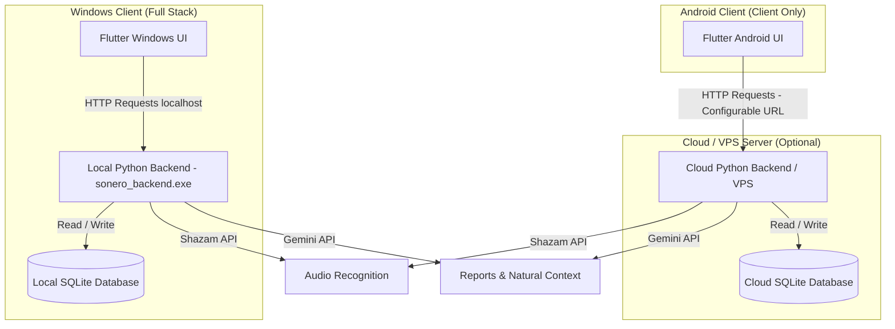
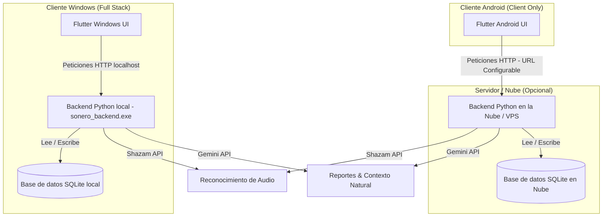

# Sonero App 🎵

[English](#english) | [Español](#español)

---

<a name="english"></a>
# Sonero App (English)

> [!IMPORTANT]
> **Direct Compiled Binaries Download**
> 
> *   🚀 **[Download Sonero Windows Installer (Full Installer)](file:///c:/Users/hbriceno/Desktop/sonero/sonero-app/installers/sonero_installer.exe)** (Contains the Flutter player + the Python audio and recognition engine).
> *   📱 **[Download Sonero Android App (.APK)](file:///c:/Users/hbriceno/Desktop/sonero/sonero-app/build/app/outputs/flutter-apk/app-release.apk)** (Lightweight client to sync and play music).
> *   *Note: If you are cloning the repository, the binaries will be generated in these folders after running the compilation commands described below.*

---

Sonero is an intelligent music player designed to optimize your focus, productivity, and emotional state based on the telemetry of your listening habits. It uses artificial intelligence (Gemini API), tempo analysis (BPM), and affective state transitions (Iso-Principle) to adapt the music to your cognitive needs.

---

## ⚙️ System Architecture (Windows vs. Android)

Sonero has a hybrid architecture to efficiently support desktop and mobile platforms:



*   **Windows (Local Full Stack)**: When starting the Windows application, Flutter automatically launches a local subprocess with the Python backend (`sonero_backend.exe` at `http://127.0.0.1:8000`). All heavy tasks (microphone/system recording, Shazam audio recognition, downloads with `yt-dlp`, and SQLite storage) are resolved on your own machine.
*   **Android (Lightweight Client)**: Android does not run Python locally. Instead, the Android app connects remotely to the Python backend (hosted on your own server, VPS, or your local PC on the same Wi-Fi network). You can configure the backend address in **Settings > API Connection** within the mobile app.

---

## ✨ Key Features

*   🧠 **Focus Score (EF)**: Calculates your concentration level in each session based on the rate of songs listened to without interruption combined with the music's instrumentalness.
*   📈 **Weekly AI Report**: Gemini analyzes your most listened tracks, distractor tracks (early skips), performance by time of day (Morning, Afternoon, Evening/Night), and music genres to write a personalized psychological productivity report.
*   🌊 **Emotional Iso-Principle**: If you are stressed or frustrated, the algorithm generates a 5-song transition queue that gradually decreases energy by 10% per track and increases affective valence to safely bring you to a state of calm.
*   🔄 **Real Google Sync & Drive Backup**: Log in securely to synchronize your history, statistics, and playlist configurations across your Windows and Android devices. Data is stored in a private, hidden JSON file (`sonero_sync.json`) within your own Google Drive application folder (`appDataFolder`), keeping your data fully private and serverless with zero host server dependencies.

---

## 🔒 Google Cloud Configuration (OAuth 2.0)

To use account synchronization and Google Drive backup in your local build or fork:
1. Create a project in the [Google Cloud Console](https://console.cloud.google.com/).
2. Enable the **Google Drive API** in your project (**APIs & Services > Library**).
3. Configure the **OAuth Consent Screen** and ensure you add the sensitive scope:
   * `https://www.googleapis.com/auth/drive.appdata` (Allows creating, reading, and deleting its own application data in your Google Drive).
4. Add the Google emails you will use for testing to the **Test Users** section (this is required for testing apps in "Testing" status before verification).
5. Create **OAuth Client ID** credentials for a **Desktop Application** (for Windows) and/or an **Android Application** (for Android).
6. Copy your **Client ID** and **Client Secret**.
7. Open the Sonero app, navigate to **Settings > Google Cloud Integration** and enter your credentials.

---

## ▶️ YouTube downloads

YouTube increasingly asks to "confirm you're not a bot", especially from VPN or datacenter IPs. To keep downloads working:
* Install **Deno** (recommended) or **Node.js**: yt-dlp needs a JavaScript runtime to solve YouTube's challenges. Sonero finds it automatically.
* Keep yt-dlp updated: `pip install -U "yt-dlp[default]"` (the `[default]` extra includes `yt-dlp-ejs`, the challenge solver).
* If downloads are still blocked, use cookies from a Google account (a secondary one is safer) in **Settings → Authentication**, or exclude Sonero from your VPN.

**Settings → Authentication** shows the status of all of this, and failed downloads explain why they failed.

## 🤖 MCP Server for AI Agents

The Python backend exposes Sonero's **usage statistics** over the [Model Context Protocol](https://modelcontextprotocol.io), so agents (Claude Code, Claude Desktop, or any MCP client) can analyze your listening habits. All tools are **read-only**: agents can't play, download, edit or delete anything.

| Tool | What it returns |
|---|---|
| `get_listening_summary` | Plays, minutes, completion rate, unique tracks/artists, peak hour/weekday, streak |
| `get_top_tracks` / `get_top_artists` / `get_top_genres` | Rankings for a period (by plays or minutes) |
| `get_listening_timeline` | Listening per day, hour of day or weekday |
| `get_playback_history` | Most recent plays |
| `get_library_overview` | Library size, formats, playlists, never-played count |
| `search_library` | Search by title, artist, album or genre, with play counts |
| `get_focus_stats` | Focus sessions, skips and Focus Score |
| `get_dashboard_stats` | Everything the in-app Statistics screen shows |
| `get_taste_profile` | Top artists/genres weighted by listening time, listening by time of day, data coverage |
| `list_library_songs` | Library songs with metadata, usage (plays, % finished, % skipped) and audio features; filters by artist, genre, BPM, energy |
| `find_similar_artists` / `get_artist_top_tracks` / `search_music_catalog` / `get_genre_chart` | Discovery in Deezer's public catalog (30 s previews), marking what's already in the library |
| `list_mixes` / `create_mix` / `delete_mix` | Recommended playlists shown in **Biblioteca → Para ti**. Writes only touch mixes, never music files |

It also provides the resource `sonero://stats/summary` (30-day summary) and the prompt **"Crear mis mixes recomendados"**, which asks the agent to analyze your data and create several Spotify/YouTube-style mixes.

### ✨ Para ti (recommended mixes)
**Biblioteca → Para ti** shows two kinds of mixes:
* **Created by your AI agent**: an agent connected to the MCP server reads your statistics, discovers new music and creates mixes with `create_mix`. Sonero itself never sends your data to any AI.
* **Made for you**: Sonero's own algorithm (no AI) — daily mix, favourites, rediscover, never played, recently added, morning/afternoon/night, high energy/calm, best of a genre, artist radios and weekly discovery through related artists (Deezer, no account needed). Without internet, only library-based mixes are created.

Online songs play as 30 s previews and can be downloaded to the library. Two optional tools improve the data the mixes use: **Completar géneros y años** (looks up missing artist/album/genre/year in Deezer/iTunes; you review before saving) and **Analizar audio** (BPM, energy, danceability computed locally; requires `pip install -r sonero-api/requirements-audio.txt`).

**HTTP (backend running):** `http://127.0.0.1:8000/mcp` — local only (not reachable from the network, DNS-rebinding protection).

```bash
claude mcp add --transport http sonero http://127.0.0.1:8000/mcp
```

**stdio (client launches it, backend not required):**

```json
{
  "mcpServers": {
    "sonero": {
      "command": "/path/to/sonero-api/venv/bin/python",
      "args": ["/path/to/sonero-api/mcp_stdio.py"]
    }
  }
}
```

Options in `sonero-api/.env`: `MCP_ENABLED=false` disables the HTTP endpoint; `MCP_TOKEN=<secret>` requires `Authorization: Bearer <secret>` (e.g. `claude mcp add --transport http sonero http://127.0.0.1:8000/mcp --header "Authorization: Bearer <secret>"`).

---

## 🛠️ Build Instructions (Developers)

### 🧹 Project Cleanup
If you want to clear Python cache files (`__pycache__`), PyInstaller spec files, and clean Flutter temporary files, double-click or run the script in the root:
```bash
.\build_clean.bat
```

### 1. Full Compilation (Windows Installer)
You can compile and package the Python backend together with the Flutter client into a single final Windows `.exe` installer by running:
```bash
.\build_all.bat
```
*   *Requirements: Install [Inno Setup 6](https://jrsoftware.org/isinfo.php) in the default path (`C:\Program Files (x86)\Inno Setup 6\ISCC.exe`) to package the final installer.*
*   The installer will be generated at: `sonero-app\installers\sonero_installer.exe`

### 2. Compile Python Backend Separately
If you only want to compile the backend executable `sonero_backend.exe` using the virtual environment's Python version:
```bash
cd sonero-api
.\build_exe.bat
```
The executable will be generated at: `sonero-api\dist\sonero_backend\sonero_backend.exe`.

### 3. Compile Android Version (.APK)
To compile the Android mobile application:
1. Ensure you have the Android SDK installed.
2. Enter the frontend folder and compile:
   ```bash
   cd sonero-app
   flutter build apk --release
   ```
The file will be generated at: `sonero-app\build\app\outputs\flutter-apk\app-release.apk`.

### ⚡ Embed OAuth Credentials in Official Build
To generate an official version ready for end-users without requiring them to configure their own Google Client ID/Secret, compile with `--dart-define` parameters:
```bash
cd sonero-app
flutter build windows --release --dart-define=DEFAULT_GOOGLE_CLIENT_ID_WINDOWS=YOUR_CLIENT_ID --dart-define=DEFAULT_GOOGLE_CLIENT_SECRET_WINDOWS=YOUR_CLIENT_SECRET
```

---

<a name="español"></a>
# Sonero App (Español)

> [!IMPORTANT]
> **Descarga Directa de Binarios Compilados**
> 
> *   🚀 **[Descargar instalador de Sonero para Windows (Full Installer)](file:///c:/Users/hbriceno/Desktop/sonero/sonero-app/installers/sonero_installer.exe)** (Contiene el reproductor Flutter + el motor de audio y reconocimiento en Python).
> *   📱 **[Descargar aplicación de Sonero para Android (.APK)](file:///c:/Users/hbriceno/Desktop/sonero/sonero-app/build/app/outputs/flutter-apk/app-release.apk)** (Cliente ligero para sincronizar y reproducir música).
> *   *Nota: Si estás clonando el repositorio, los binarios se generarán en esas carpetas tras ejecutar los comandos de compilación descritos más abajo.*

---

Sonero es un reproductor inteligente de música diseñado para optimizar tu concentración, productividad y estado emocional en base a la telemetría de tus hábitos de escucha. Utiliza inteligencia artificial (Gemini API), análisis de tempo (BPM) y la transición de estados afectivos (Iso-Principio) para adaptar la música a tus necesidades cognitivas.

---

## ⚙️ Arquitectura del Sistema (Windows vs. Android)

Sonero tiene una arquitectura híbrida para dar soporte a plataformas de escritorio y móviles de forma eficiente:



*   **Windows (Full Stack Local)**: Al iniciar la aplicación de Windows, Flutter levanta automáticamente un subproceso local con el backend de Python (`sonero_backend.exe` en `http://127.0.0.1:8000`). Todas las tareas pesadas (grabación del micrófono/sistema, reconocimiento de audio con Shazam, descargas con `yt-dlp` y almacenamiento en SQLite) se resuelven en tu propia máquina.
*   **Android (Cliente Ligero)**: Android no ejecuta Python localmente. En su lugar, la app de Android se conecta de forma remota al backend de Python (alojado en un servidor propio, VPS o tu PC local en la misma red de Wi-Fi). Puedes configurar la dirección del backend en **Ajustes > Conexión de API** en la aplicación móvil.

---

## ✨ Características Principales

*   🧠 **Focus Score (EF)**: Calcula tu nivel de concentración en cada sesión basándose en la tasa de canciones escuchadas sin interrupciones combinada con la instrumentalidad de la música.
*   📈 **Reporte Semanal con IA**: Gemini analiza tus canciones más escuchadas, canciones distractoras (skips tempranos), rendimiento por horas (Mañana, Tarde, Noche) y géneros musicales para redactar un informe de productividad psicológica personalizado.
*   🌊 **Iso-Principio Emocional**: Si estás estresado o frustrado, el algoritmo genera una cola de transición de 5 canciones que disminuye gradualmente la energía en un 10% por pista y aumenta la valencia afectiva para llevarte de forma segura a un estado de calma.
*   🔄 **Sincronización Real con Google y Respaldo en Drive**: Inicia sesión de forma segura para sincronizar tu historial, estadísticas y configuraciones de playlist entre tus dispositivos Windows y Android. Los datos se almacenan en un archivo JSON privado y oculto (`sonero_sync.json`) dentro de la carpeta de aplicación de tu propio Google Drive (`appDataFolder`), manteniendo tus datos privados y sin depender de servidores intermediarios.

---

## 🔒 Configuración de Google Cloud (OAuth 2.0)

Para usar la sincronización de cuenta y respaldo en Google Drive en tu compilación local o fork:
1. Crea un proyecto en la [Google Cloud Console](https://console.cloud.google.com/).
2. Habilita la **Google Drive API** en tu proyecto (**APIs y servicios > Biblioteca**).
3. Configura la **Pantalla de consentimiento de OAuth** (Consent Screen) y asegúrate de agregar el permiso sensible:
   * `https://www.googleapis.com/auth/drive.appdata` (Permite crear, leer y borrar sus propios datos de configuración de la aplicación en Google Drive).
4. Agrega los correos de Google que usarás para pruebas en la sección de **Usuarios de prueba** (Test users).
5. Crea credenciales de **ID de cliente de OAuth** para **Aplicación de escritorio** (Desktop App, para Windows) y/o **Aplicación de Android** (para Android).
6. Copia tu **Client ID** y **Client Secret**.
7. Abre la aplicación Sonero, navega a **Ajustes > Integración con Google Cloud** e introduce tus claves.

---

## ▶️ Descargas de YouTube

YouTube pide cada vez más "confirmar que no eres un bot", sobre todo desde IPs de VPN o centros de datos. Para que las descargas sigan funcionando:
* Instala **Deno** (recomendado) o **Node.js**: yt-dlp necesita un motor de JavaScript para resolver los desafíos de YouTube. Sonero lo encuentra solo.
* Mantén yt-dlp actualizado: `pip install -U "yt-dlp[default]"` (el extra `[default]` incluye `yt-dlp-ejs`, que resuelve los desafíos).
* Si aun así se bloquean, usa cookies de una cuenta de Google (mejor una secundaria) en **Ajustes → Autenticación**, o excluye Sonero de tu VPN.

**Ajustes → Autenticación** muestra el estado de todo esto, y las descargas fallidas explican por qué fallaron.

## 🤖 Servidor MCP para Agentes de IA

El backend de Python expone las **estadísticas de uso** de Sonero mediante el [Model Context Protocol](https://modelcontextprotocol.io), para que agentes (Claude Code, Claude Desktop o cualquier cliente MCP) puedan analizar tus hábitos de escucha. Todas las herramientas son de **solo lectura**: los agentes no pueden reproducir, descargar, editar ni borrar nada.

| Herramienta | Qué devuelve |
|---|---|
| `get_listening_summary` | Reproducciones, minutos, tasa de canciones terminadas, canciones/artistas distintos, hora y día pico, racha |
| `get_top_tracks` / `get_top_artists` / `get_top_genres` | Rankings de un periodo (por reproducciones o minutos) |
| `get_listening_timeline` | Escucha por día, hora del día o día de la semana |
| `get_playback_history` | Últimas reproducciones |
| `get_library_overview` | Tamaño de la biblioteca, formatos, playlists, canciones nunca escuchadas |
| `search_library` | Búsqueda por título, artista, álbum o género, con número de reproducciones |
| `get_focus_stats` | Sesiones de concentración, saltos y Focus Score |
| `get_dashboard_stats` | Todo lo que muestra la pantalla de Estadísticas de la app |
| `get_taste_profile` | Artistas y géneros más escuchados (ponderados por tiempo), escucha por momento del día, cobertura de datos |
| `list_library_songs` | Canciones con metadatos, uso (reproducciones, % terminado, % saltado) y análisis de audio; filtros por artista, género, BPM, energía |
| `find_similar_artists` / `get_artist_top_tracks` / `search_music_catalog` / `get_genre_chart` | Descubrimiento en el catálogo público de Deezer (vistas previas de 30 s), marcando lo que ya está en la biblioteca |
| `list_mixes` / `create_mix` / `delete_mix` | Playlists recomendadas que aparecen en **Biblioteca → Para ti**. Solo modifican los mixes, nunca los archivos de música |

También ofrece el recurso `sonero://stats/summary` (resumen de 30 días) y el prompt **"Crear mis mixes recomendados"**, que pide al agente analizar tus datos y crear varios mixes al estilo Spotify/YouTube.

### ✨ Para ti (mixes recomendados)
**Biblioteca → Para ti** muestra dos tipos de mixes:
* **Creados por tu agente IA**: un agente conectado al servidor MCP lee tus estadísticas, descubre música nueva y crea mixes con `create_mix`. Sonero no envía tus datos a ninguna IA por su cuenta.
* **Hechos para ti**: el algoritmo propio de Sonero (sin IA) — mix diario, favoritas, redescubre, nunca escuchadas, recién añadidas, mañana/tarde/noche, alta energía/calma, lo mejor de un género, radios de artista y descubrimiento semanal mediante artistas relacionados (Deezer, sin cuenta). Sin internet se crean solo los mixes de tu biblioteca.

Las canciones nuevas se escuchan como vistas previas de 30 s y se pueden descargar a la biblioteca. Dos herramientas opcionales mejoran los datos que usan los mixes: **Completar géneros y años** (busca artista/álbum/género/año faltantes en Deezer/iTunes; los revisas antes de guardar) y **Analizar audio** (BPM, energía y bailabilidad calculados localmente; requiere `pip install -r sonero-api/requirements-audio.txt`).

**HTTP (con el backend en ejecución):** `http://127.0.0.1:8000/mcp` — solo local (no accesible desde la red, con protección contra DNS rebinding).

```bash
claude mcp add --transport http sonero http://127.0.0.1:8000/mcp
```

**stdio (el cliente lo lanza; no requiere el backend):**

```json
{
  "mcpServers": {
    "sonero": {
      "command": "/ruta/a/sonero-api/venv/bin/python",
      "args": ["/ruta/a/sonero-api/mcp_stdio.py"]
    }
  }
}
```

Opciones en `sonero-api/.env`: `MCP_ENABLED=false` desactiva el endpoint HTTP; `MCP_TOKEN=<secreto>` exige `Authorization: Bearer <secreto>` (p. ej. `claude mcp add --transport http sonero http://127.0.0.1:8000/mcp --header "Authorization: Bearer <secreto>"`).

---

## 🛠️ Instrucciones de Compilación (Desarrolladores)

### 🧹 Limpieza del Proyecto
Si deseas borrar archivos de caché de Python (`__pycache__`), especificaciones de PyInstaller y limpiar temporales de Flutter, haz doble clic o ejecuta el script en la raíz:
```bash
.\build_clean.bat
```

### 1. Compilación Completa (Windows Installer)
Puedes compilar y empaquetar el backend de Python junto con el cliente Flutter en un único instalador final de Windows `.exe` ejecutando:
```bash
.\build_all.bat
```
*   *Requisitos: Tener instalado [Inno Setup 6](https://jrsoftware.org/isinfo.php) en la ruta por defecto (`C:\Program Files (x86)\Inno Setup 6\ISCC.exe`) para empaquetar el instalador final.*
*   El instalador se generará en: `sonero-app\installers\sonero_installer.exe`

### 2. Compilar el Backend Python por separado
Si solo deseas compilar el ejecutable del backend `sonero_backend.exe` usando la versión de Python del entorno virtual:
```bash
cd sonero-api
.\build_exe.bat
```
El ejecutable se generará en: `sonero-api\dist\sonero_backend\sonero_backend.exe`.

### 3. Compilar la versión de Android (.APK)
Para compilar la aplicación móvil de Android:
1. Asegúrate de tener instalado el SDK de Android.
2. Entra a la carpeta del frontend y compila:
   ```bash
   cd sonero-app
   flutter build apk --release
   ```
El archivo se generará en: `sonero-app\build\app\outputs\flutter-apk\app-release.apk`.

### ⚡ Incrustar Credenciales OAuth en Compilación Oficial
Para generar una versión oficial lista para usar donde el usuario final no tenga que configurar su Client ID/Secret de Google, compila con parámetros `--dart-define`:
```bash
cd sonero-app
flutter build windows --release --dart-define=DEFAULT_GOOGLE_CLIENT_ID_WINDOWS=TU_CLIENT_ID --dart-define=DEFAULT_GOOGLE_CLIENT_SECRET_WINDOWS=TU_CLIENT_SECRET
```
